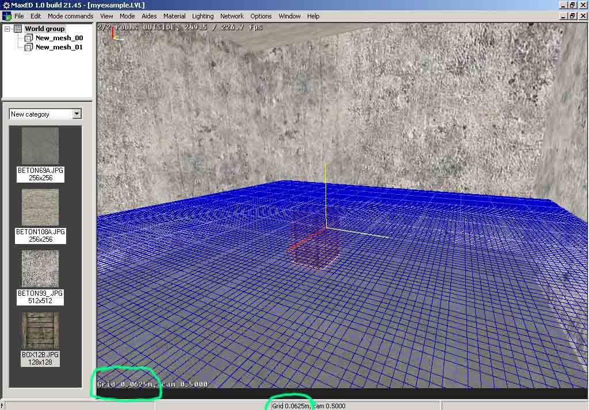
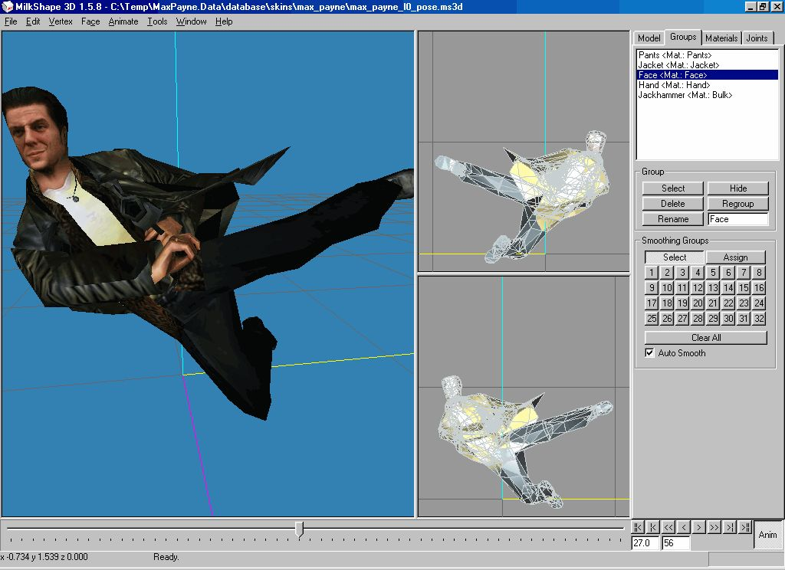
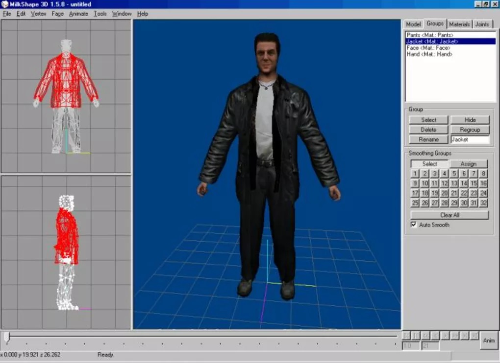
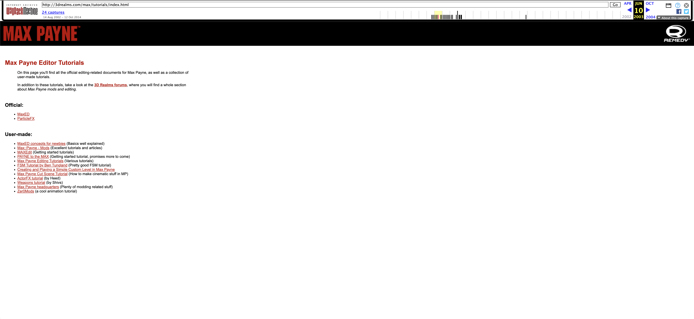

# max-payne-2001
## Max Payne 2001
Max Payne 2001 PC and MaxEd 

## Github Treeview
[https://treegit.macosxjs.com/?url=igiteam/max-payne-2001](https://treegit.macosxjs.com/?url=igiteam/max-payne-2001)

## Github Tree Api Direct JSON
[https://api.github.com/repos/igiteam/max-payne-2001/git/trees/main?recursive=1](https://api.github.com/repos/igiteam/max-payne-2001/git/trees/main?recursive=1)

## Base gameplay
[](https://ytembed.macosxjs.com/?Y1kwR2s3MVRBR0k)

[](https://ytembed.macosxjs.com/?MGJmRzRvTEV4cUU)

[](https://ytembed.macosxjs.com/?ekUydTBXcEl6OXc)






## WS11WineCX20.0.4 (MacOSX Big Sur 32bit)
[WS11WineCX20.0.4.tar.7z](https://github.com/vitor251093/porting-kit-engines/releases/download/wineskin/WS11WineCX20.0.4.tar.7z)

[](https://github.com/igiteam/wine_engines)


## Reference links
[https://archive.org/details/sinatar_Max_Payne_2001](https://archive.org/details/sinatar_Max_Payne_2001)

[https://www.moddb.com/games/max-payne/tutorials](https://www.moddb.com/games/max-payne/tutorials)

[https://www.moddb.com/games/max-payne/downloads/max-fx-tools](https://www.moddb.com/games/max-payne/downloads/max-fx-tools)

[](https://web.archive.org/web/20030610151351/http://3drealms.com/max/tutorials/index.html)

[](https://archive.org/details/Max_Payne_Reissue_USA)


# payne-recomp

Max Payne (Xbox, PAL) as a native program for Windows and Apple Silicon Macs.
You supply your own copy of the game. Its code is translated to C on your
machine and compiled against the
[DirectXbox-Recomp](https://github.com/phobos665/DirectXbox-Recomp) toolkit. This repository
holds no game code or data.

[Gameplay on macOS (video)](https://www.youtube.com/watch?v=cY0Gk71TAGI)

## Status

**Playable.** Last checked on 2 Nov 2026 against DirectXbox-Recomp `main` (`a316171`),
on an Apple Silicon Mac, with scripted input:

| | |
| --- | --- |
| Start-up, intro movie, main menu | Works, with sound |
| New Game: opening cutscene, graphic novel, narration | Works |
| Levels | All 67 load through the game's level select. Each played for 48 s (walking, shooting, taking hits) without a fault |
| Frame rate | 60 fps |
| Sound | No dropouts measured in any run (muted test runs; not yet re-checked by ear) |
| Crashes fixed | The occasional one before the menu (about 1 start in 10), and the one in *Rooftops and Alleys* 3 |
| Widescreen | Optional (launcher switch); see [Widescreen](#widescreen) |

No known crashes. Not checked yet: a level played to its end, loading a save, the credits.
Windows was last checked on an older toolkit.

## What you need

- Windows 10/11 (64-bit) **or** a Mac with Apple Silicon
- Windows: Visual Studio 2022 or 2019 with **Desktop development with C++**
- macOS: Xcode command line tools, Homebrew `cmake` and `ninja`, and the
  [Vulkan SDK](https://vulkan.lunarg.com/)
- CMake 3.20+, Git, and Python 3.10+ with `capstone`
  (`python3 -m pip install capstone`)
- **Max Payne, PAL release**, extracted from your disc

## Build

```sh
git clone --recursive https://github.com/phobos665/payne-recomp.git
cd payne-recomp
```

Copy the extracted disc into a folder called `game`, so `game/default.xbe`
exists with `data/`, `english/` and the rest beside it. Then:

```sh
python3 scripts/build.py      # Windows: py -3 scripts\build.py
```

The first run translates the game (a few minutes), then compiles it. The
program lands in `build/Release/`: `payne_recomp` (the game) and
`payne_recomp_launcher` (settings, then the game). On Windows these are
`.exe` files.

Cloned without `--recursive`? Run `git submodule update --init`, then in
`xboxrecomp/`: `git submodule update --init third_party/SDL third_party/volk
third_party/Vulkan-Headers third_party/VulkanMemoryAllocator
third_party/libsamplerate third_party/miniupnp`. Those are all the build needs.

## Play

Start `payne_recomp_launcher` to pick settings, or `payne_recomp` to play
straight away.

An Xbox or XInput controller works as itself. On the keyboard: arrows = D-pad,
Enter = Start, Backspace = Back, Z = A, X = B, A = X, S = Y, Q = White,
W = Black, E = left trigger, R = right trigger. Rebind in the launcher's Input
tab.

| Key | Does |
| --- | --- |
| F9 | Show or hide the frame rate |
| F10 | Step the frame cap: adaptive, 60, 30, off |
| F11 | Save a screenshot and a frame capture beside the program, for bug reports |

| What | Where |
| --- | --- |
| Saves | `game/UDATA/54540003/` |
| Settings | `%APPDATA%\xboxrecomp\titles\54540003.conf`; on macOS `~/Library/Application Support/xboxrecomp/titles/54540003.conf` |
| Log | `build/Release/payne_recomp.log`, when started without a terminal |

### Widescreen

Turn on **Widescreen** in the launcher. The game has no 16:9 mode of its own,
so the camera is widened instead (Hor+). Menus, loading screens and movies stay
4:3 between bars. The HUD stays in the middle 4:3 area.

## Updating

```sh
git pull
git submodule update --recursive
python3 scripts/build.py --relift
```

`--relift` translates the game again. Do it whenever the toolkit or `config/`
changes.

## Problems

- **"no default.xbe in ..."**: the disc contents are not in `game/`.
- **Black window**: read the log (above).
- **Something draws wrong in one place**: press F11 there and attach the
  `.bmp` and `.d3dcap` it writes to an issue.
- **A different disc**: `config/` holds addresses inside the PAL
  `default.xbe` (SHA-1 `3250db85…`). The build warns if yours differs; other
  versions need their own. Please open an issue with the SHA-1 it prints.

## Legal

You need your own copy of Max Payne. Do not share `game/`, `src/recomp/`
(translated game code) or anything under `build/`. This repository and
xboxrecomp contain no game code or assets.


## Dev Environment

**Official White Wii Remote With Nunchuk — Tested And Working — £14.99**
[https://www.ebay.co.uk/itm/800847189353](https://www.ebay.co.uk/itm/800847189353)

**Infrared Sensor Bar USB for Wii Emulator Remote Motion Detection Setup — £6.69**
[https://www.ebay.co.uk/itm/227423830875](https://www.ebay.co.uk/itm/227423830875)

**Apple MacBook Pro Retina 15in (2014) i7 2.8GHz 16GB 1TB SSD GT 750M — £120.30**
[https://www.ebay.co.uk/itm/800844561513](https://www.ebay.co.uk/itm/800844561513)

**WS11WineCX20.0.4 (Wine engine)**
[https://igiteam.github.io/wine_engines/](https://igiteam.github.io/wine_engines/)

**Official Genuine Sony PS3 PlayStation 3 DualShock 3 Wireless Controller Black — £19.99**
[https://www.ebay.co.uk/itm/840031043465](https://www.ebay.co.uk/itm/840031043465)

**Amazon Basics 4K HDMI Cable 3m — 18Gbps High Speed with Ethernet, 4K@60Hz, 2160p — £8.44**
[https://www.ebay.co.uk/itm/327352257557](https://www.ebay.co.uk/itm/327352257557)

**wiimote_nunchuk_macosx**
[https://github.com/igiteam/wiimote-nunchuk](https://github.com/igiteam/wiimote-nunchuk)

**xbox360_input_gui_py**
[https://github.com/igiteam/xbox360_input_gui_py](https://github.com/igiteam/xbox360_input_gui_py)

**logitec_mx_mouse_3_macos**
[https://github.com/igiteam/logitec_mx_mouse_3_macos](https://github.com/igiteam/logitec_mx_mouse_3_macos)

**igi1-macbook-3d-workstation**
[https://github.com/igiteam/igi1-macbook-3d-workstation](https://github.com/igiteam/igi1-macbook-3d-workstation)

---


